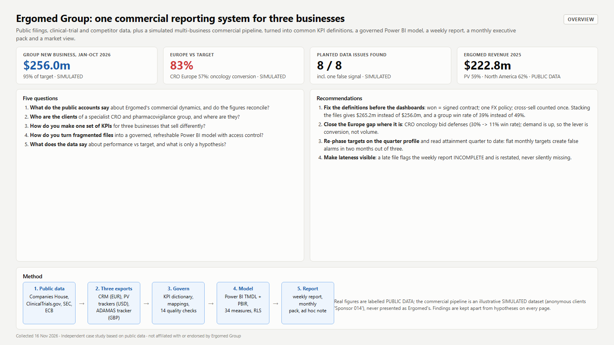
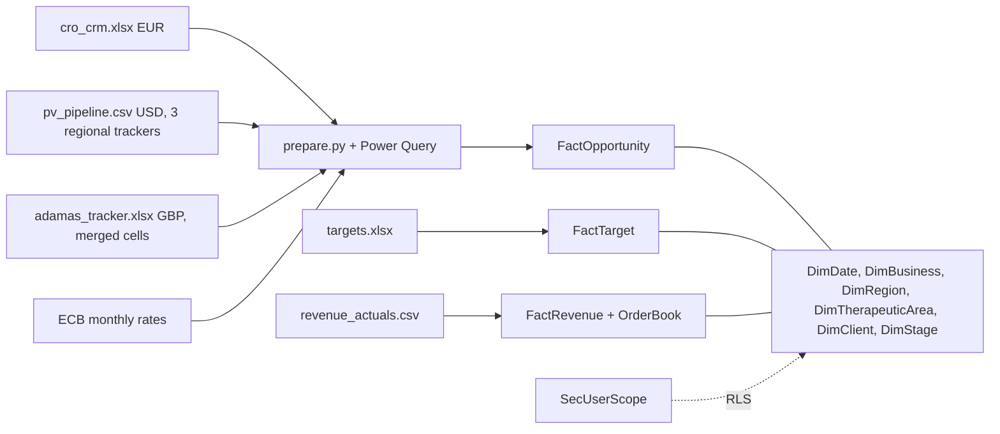
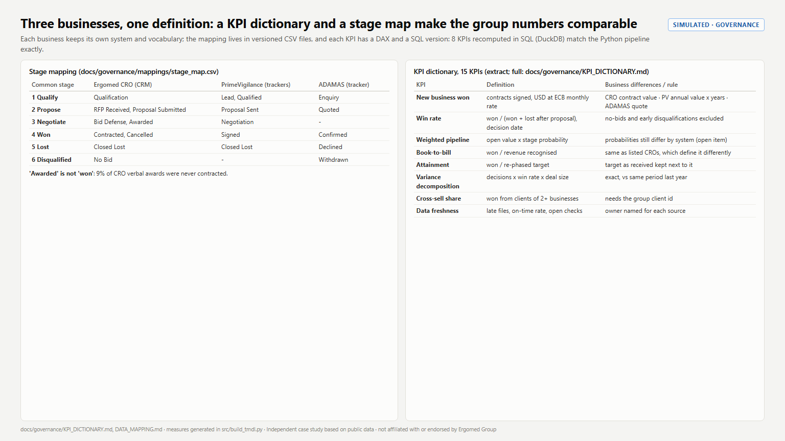
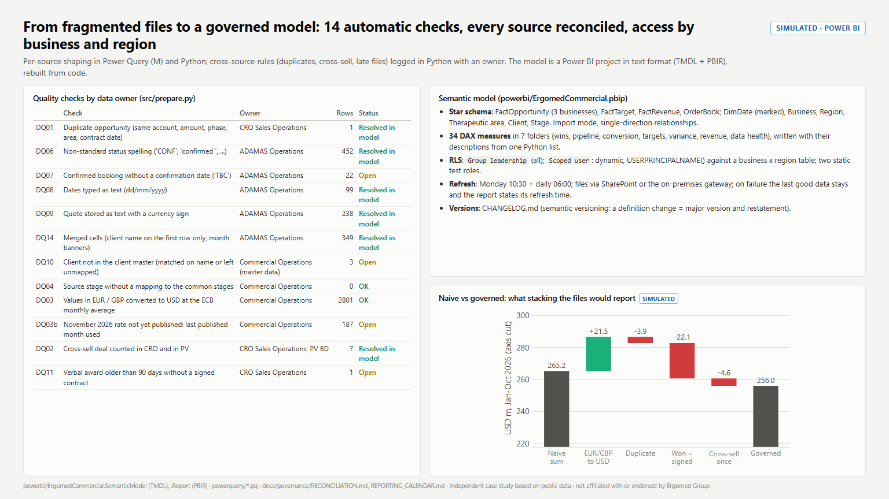
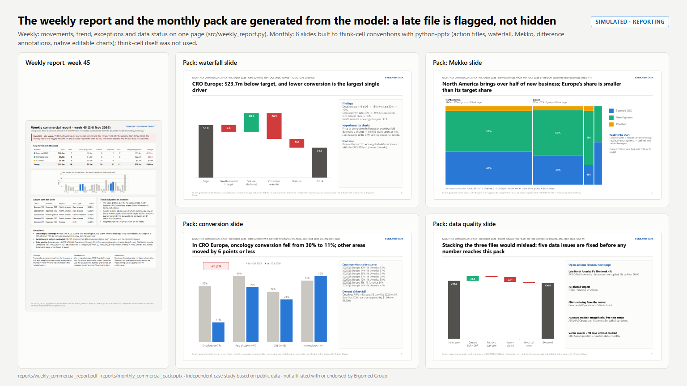
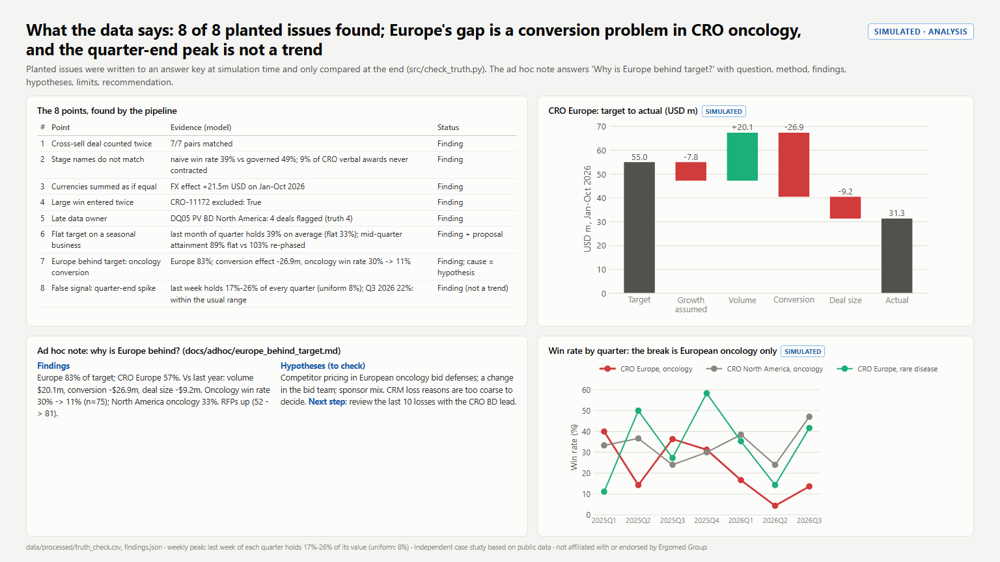

# Ergomed Group: one commercial reporting system for three businesses

Public filings, clinical-trial and competitor data, plus a simulated multi-business commercial pipeline, turned into common
KPI definitions, a governed Power BI model, a weekly report, a monthly executive pack and a market view.

*Independent case study based on public data · not affiliated with or endorsed by Ergomed Group.*
Real figures are labelled **PUBLIC DATA**; the commercial pipeline is an **illustrative SIMULATED dataset** (anonymous
clients such as "Sponsor 014"), never presented as Ergomed's.

| Deliverable | File |
|---|---|
| 8-page report (PDF) | [docs/Ergomed_Commercial_Reporting_Case_Study.pdf](docs/Ergomed_Commercial_Reporting_Case_Study.pdf) |
| Power BI project, 5 pages (TMDL + PBIR) | [powerbi/ErgomedCommercial.pbip](powerbi/ErgomedCommercial.pbip) · [how to open](powerbi/POWERBI_STEPS.md) |
| Monthly commercial pack, 8 slides | [reports/monthly_commercial_pack.pptx](reports/monthly_commercial_pack.pptx) |
| Weekly commercial report, 1 page | [reports/weekly_commercial_report.pdf](reports/weekly_commercial_report.pdf) |
| Ad hoc note: why is Europe behind target? | [docs/adhoc/europe_behind_target.md](docs/adhoc/europe_behind_target.md) |
| Governance: KPI dictionary, mapping, reconciliation, changelog, calendar | [docs/governance/](docs/governance/) |
| Market and public data notebook | [notebooks/market_and_public_data.ipynb](notebooks/market_and_public_data.ipynb) |



## Four results
1. **The filed accounts reconcile, with explained gaps** (PUBLIC DATA). Ergomed's order book grew from GBP 124m (2019) to
   GBP 324m (2023); in 2021 the published net awards close the order-book roll-forward exactly (193.0 + 165.3 - 118.6 = 239.7).
   Eight checks are documented, including a transposed total in a 2025 note (244,725 printed, rows sum to 244,275) and the
   2023 -> 2024 break (GBP -> USD, 12 -> 13.5 months, new reporting entity).
2. **Who the clients are** (PUBLIC DATA). 68% of the 8,693 industry-sponsored oncology and rare-disease studies started
   since 2019 on ClinicalTrials.gov are run by small and mid-size sponsors; listed CROs reported book-to-bill of 1.0x-1.2x.
3. **Stacking the three files would mislead** (SIMULATED). Naive sum USD 265.2m vs governed USD 256.0m for Jan-Oct 2026, and a
   group win rate of 39% vs 49%: currencies mixed, a CRM win keyed twice, verbal awards counted as wins, cross-sell counted
   twice. All 8 planted issues were found, including a late regional file and one false signal (the quarter-end peak).
4. **Europe's gap is a conversion problem, not a demand problem** (SIMULATED). Group at 95% of target; Europe 83%; CRO Europe
   57%. Vs last year: volume +USD 20.1m, conversion -USD 26.9m, deal size -USD 9.2m; oncology win rate 30% -> 11% while
   oncology RFPs rose. The cause behind it stays a hypothesis until checked with the business.

## Model

34 DAX measures (30 KPIs + 4 helpers), 4 roles (group leadership, dynamic business x region, 2 static test roles),
refresh and gateway documented in [REPORTING_CALENDAR.md](docs/governance/REPORTING_CALENDAR.md).

| | |
|---|---|
|  |  |
|  |  |

## How to rerun
```bash
python -m venv .venv && .venv\Scripts\activate && pip install -r requirements.txt
python src/collect_public.py        # Companies House PDFs + group web pages (optional key in .env)
python src/pdf_text.py              # OCR of the scanned filings (Windows OCR), to search and cite pages
python src/collect_trials.py        # ClinicalTrials.gov API v2
python src/collect_competitors.py   # SEC EDGAR filings
python src/collect_fx.py            # ECB monthly FX
python src/run_all.py               # simulate -> prepare -> analysis -> checks -> Power BI -> docs -> reports -> PDF
```
Single steps: `python src/simulate.py`, `python src/prepare.py`, open `powerbi/ErgomedCommercial.pbip` (see
[POWERBI_STEPS.md](powerbi/POWERBI_STEPS.md)), `python src/weekly_report.py`, `python src/build_monthly_pack.py`,
`python src/build_pdf.py`. Raw downloads (`data/raw/`) are not redistributed.

## Sources
Companies House (Ergomed Group Limited 04081094, formerly Ergomed plc; Eden TopCo Limited 15049295), group websites,
ClinicalTrials.gov API v2, SEC EDGAR (Medpace, IQVIA, ICON), ICON results releases, ECB Data Portal. Details and dates:
[data/SOURCES.md](data/SOURCES.md). Simulation assumptions: [data/ASSUMPTIONS.md](data/ASSUMPTIONS.md).

## Limits
- The commercial pipeline is simulated and illustrative; no conclusion about Ergomed's performance follows from it.
- Ergomed figures are historical, from published filings only; nothing is said about the company beyond them.
- The rare-disease flag on ClinicalTrials.gov is a proxy; competitor KPIs are defined differently by each company.
- The pack is built to think-cell conventions with python-pptx; think-cell itself was not used.
- The Power Query files follow the pipeline rules but were not refreshed in Power BI Desktop here (migration path).
- No person names are kept (directors in filings, investigators in the registry).

## Methods
Python (pandas, DuckDB, matplotlib, python-pptx), Power BI (TMDL + PBIR generated from code), Power Query M, SQL.
Each number in the PDF, the pack and the reports is read from a pipeline output; KPIs are recomputed in SQL and matched.

AI-assisted workflow: I used Claude, mainly to write scripts faster. I drove the project: I defined the questions, chose and validated the data sources, made the analytical decisions and checked every result.
